<!-- Colours and fonts follow the portfolio theme: https://devarfan.vercel.app -->

<a href="https://devarfan.vercel.app"></a><a href="https://drive.google.com/file/d/1RCRYBElkanUGNkXwi3zNq1OCb7iJuSqh/view?usp=sharing"></a>

 


 


 


 
 

<a href="https://devarfan.vercel.app/projects/met-club-website"></a>

 


 
 

<a href="https://devarfan.vercel.app/contact">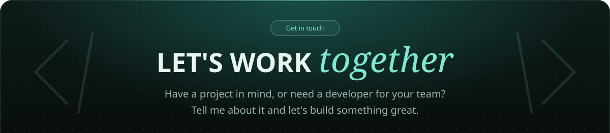</a><a href="https://devarfan.vercel.app/contact">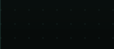</a><a href="https://www.linkedin.com/in/arfan-ahmed-shohag/">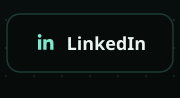</a><a href="https://devarfan.vercel.app/contact">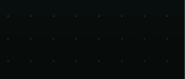</a>

