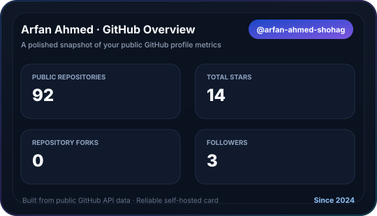
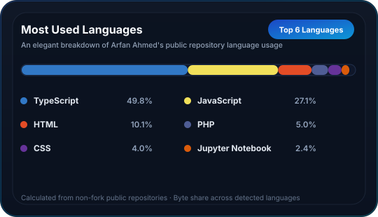

<!-- Colours and fonts follow the portfolio theme: https://devarfan.vercel.app -->
<div align="center">

<a href="https://devarfan.vercel.app"></a>

<p>
<a href="https://devarfan.vercel.app"></a>
<a href="https://wa.me/8801615391684"></a>
<a href="https://drive.google.com/file/d/1RCRYBElkanUGNkXwi3zNq1OCb7iJuSqh/view?usp=sharing"></a>
</p>

<br />


</div>

I'm **Arfan**, a full stack developer based in Dhaka, Bangladesh. I build fast, scalable web apps with the **MERN stack** and ship polished marketing sites in **WordPress** and **Webflow**. I like turning ideas into clean, responsive, production-ready products, from the database and API to the last pixel on screen.

```ts
const arfan = {
  role: "Full Stack Developer",
  location: "Dhaka, Bangladesh",
  currently: "Web Developer at Exprovia",
  stack: ["MERN", "Next.js", "NestJS", "WordPress", "Webflow"],
  education: "B.Sc. Engg. in CSE, PSTU",
};
```

<div align="center">

<br />


<br />





<br />
<br />


<a href="https://devarfan.vercel.app/projects/met-club-website"></a>
<a href="https://devarfan.vercel.app/projects/e-learning-platform"></a>
<a href="https://devarfan.vercel.app/projects/zero-olympiad"></a>
<a href="https://devarfan.vercel.app/projects/real-estate-website"></a>

<p><a href="https://devarfan.vercel.app/projects"></a></p>

<br />





<br />
<br />

<a href="https://devarfan.vercel.app/contact"></a>

Have a project in mind, or need a developer for your team? Tell me about it.

<p>
<a href="https://wa.me/8801615391684"></a>
<a href="mailto:arfan.exprovia@gmail.com"></a>
<a href="https://www.linkedin.com/in/arfan-ahmed-shohag/"></a>
<a href="https://www.facebook.com/arfan.arfanahmed.73"></a>
</p>

</div>
